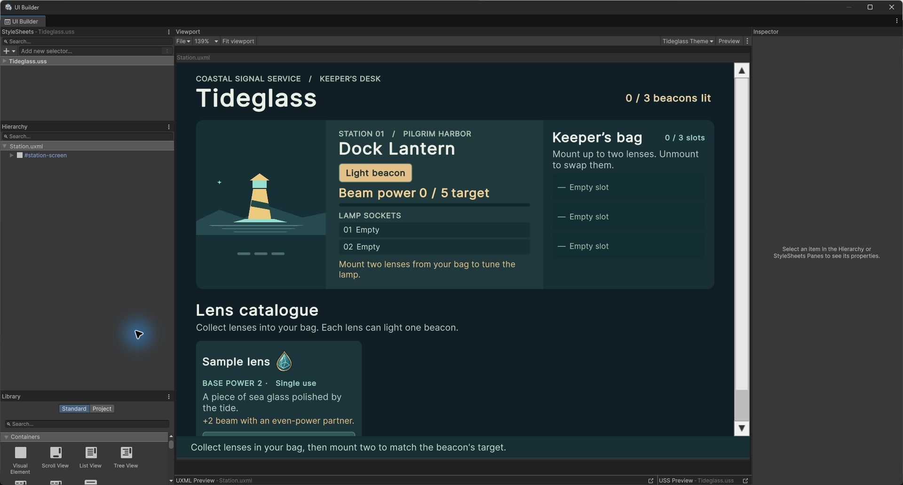
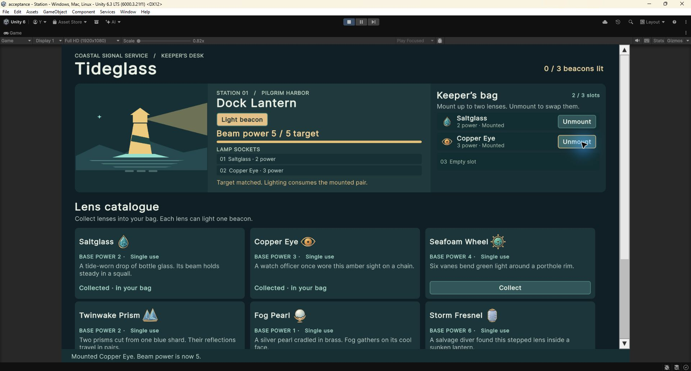

# Verification

## Automated checks

Open the project in Unity **6000.3.21f1**. In **Window → General → Test Runner**, run EditMode and PlayMode separately. The authored eight-lens coast currently has **19 EditMode** tests and **3 PlayMode** tests.

On Windows, close any Editor instance using this project and run from the project root:

```powershell
.\Tools\Verify.ps1
```

The script uses the version in `ProjectSettings/ProjectVersion.txt`, writes NUnit XML and Editor logs to `TestResults/`, and fails on missing, skipped or failed tests. Pass `-Unity 'D:\Unity\6000.3.21f1\Editor\Unity.exe'` if the Editor is installed outside the default Hub path.

| Suite | Coverage |
| --- | --- |
| GameSessionTests (10) | Three-item capacity, duplicate and locked collection, mounting, unmounting, failed and successful ignition, retention, resonance and completion. |
| CoastContentTests (5) | Imported icons, unlock thresholds, scene and styles, missing references, duplicate IDs and the scene's reference to the authored UXML. |
| CoastRouteTests (4) | The main and alternative routes, Anchor with Crown, and exhaustive reachability using the real session and `Coast.asset`. |
| StationPlayModeTests (3) | Full route through the actual UI controls, visibility and keyboard focus, preservation of rearranged elements during actions, and scrolling to the final card at both widths. |

The reachability test collects each permitted item and tries every pair through `GameSession`. Mounted configurations can be unmounted without changing the bag, so the search normalizes sockets between choices. It checks that every reachable nonterminal bag and spent-lens state can still lead to completion. For the original eight lenses, it also checks **7** different sequences of consumed pairs and **17** full bags, split **1 / 4 / 12** across the three beacons. The exact counts are checked only for that reference configuration.

## Manual review

1. Start the Station scene at 1280 × 720. Collect Saltglass, Copper Eye and Seafoam Wheel. The bag reads 3 / 3, both sockets are empty and the beam remains 0 / 5.
2. Mount Saltglass and Seafoam Wheel for 6 / 5. Unmount the wheel and check that it stays in the bag. Mount Copper Eye for 5 / 5 and light Dock Lantern. The pair is spent and the wheel remains in the bag.
3. Collect Twinwake Prism. Mount the wheel and prism for 8 / 8, then light Bell Buoy. Collect Storm Fresnel and Fog Pearl. Mount them for 10 / 10 and light Northlight.
4. In a fresh session, keep the wheel while lighting Dock Lantern. Mount Anchor Glass and Fog Pearl at Bell Buoy for 8. At Northlight, mount the wheel and Crown Glass for 10. Another valid route keeps Anchor for Northlight and pairs it with Crown for 10 without a resonance bonus.
5. Check 1280 × 720 and 600 × 720. Use the mouse and keyboard, check the named unlock conditions and status messages, and scroll to Anchor Glass and Crown Glass at the bottom of the catalogue.
6. In a disposable copy, add a lens as described in the README. Check its icon, power, unlock condition and effect hint. Run the content tests after changing the coast.
7. In **File → Build Profiles**, select a desktop target, confirm Station is enabled and choose **Build and Run**. Repeat the main route in the player.

## Editable view verification on 2026-11-09

Unity **6000.3.21f1** passed **19 EditMode** and **3 PlayMode** tests. The full route test used live button events through all three beacons. A separate test rearranged the instantiated tree and verified that Collect, Mount and Ignite preserved the same elements and their order. The EditMode scene test checked the assigned `Station.uxml` source asset.

In a disposable editor copy with Play Mode stopped, I dragged `ignite` above `beam-indicator` in the UI Builder Hierarchy, then opened `LensCard.uxml` and dragged `lens-title` before `lens-icon`. I saved both documents through UI Builder. In Game view I collected and mounted Saltglass and Copper Eye. The button stayed above the beam at 5 / 5, and the title preceded the icon on all eight cards. Clicking the moved button lit Dock Lantern and advanced to Bell Buoy. The saved demonstration edits are in the disposable copy.





[LensCard template in UI Builder](ReviewImages/lens-card-builder.jpg)

The Windows x64 player was checked at **1280 × 720** and **600 × 720**. At the wider size, Tab and Enter collected lenses, focus stayed on Mount as it became Unmount, and pressing Enter after ignition mounted the retained Seafoam Wheel at Bell Buoy. Crown Glass and its unlock hint were reachable by scrolling at both sizes.

Both player logs recorded the existing nonfatal Direct3D 12 InfoQueue diagnostic `0x80004002`. The game rendered and neither log reported a game script exception.
