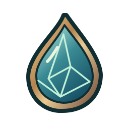
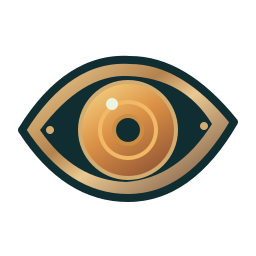
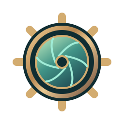
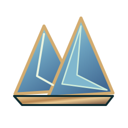
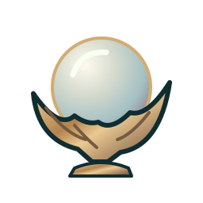
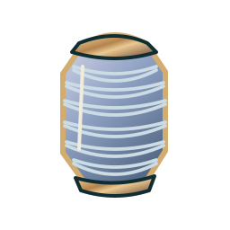

# Tideglass

A short collection puzzle for the [Azulon Unity Technical Challenge](https://azulon-studios.notion.site/Azulon-Unity-Technical-Challenge-318a171fde23808c91fec583552481ab). A storm has darkened three lights along the coast. As their keeper, salvage optical lenses, fit two into the lamp and match the signal each beacon needs.

      

## Run

1. Extract the archive. In Unity Hub, choose **Add project from disk** and select the **Tideglass** folder containing `Assets`, `Packages` and `ProjectSettings`.
2. Open it with **Unity 6000.3.28f1**. Allow the first package resolution and asset import to finish.
3. Open `Assets/Tideglass/Scenes/Station.unity` and press **Play**. Start with a 1280 × 720 Game view. The same scene is enabled for standalone builds.
4. Collect two lenses from the catalogue. Mount them in the inventory. Match the beam to the target, then light the beacon to unlock the next stretch of coast.

Each play session starts a fresh route. Lenses stay in your inventory between beacons. Lighting one clears its sockets so you can tune the next signal. A lens with a resonance bonus reads its partner's **printed base power**. Both bonuses are evaluated independently.

## Where to look

| Path under `Assets/Tideglass` | Responsibility |
| --- | --- |
| `Runtime/Domain/` | A plain C# session owns inventory, sockets, calibration and route progression. The assembly has no engine references. |
| `Runtime/Content/` and `Data/` | ScriptableObjects define the coast, lenses, icon references and reusable effects. The coast turns authoring data into a fresh session. |
| `Runtime/Station.cs` | The scene entry point connects the catalogue, session and UI document. |
| `Runtime/Presentation/` and `Resources/Interface/` | UI Toolkit renders the catalogue, player inventory and lamp. It sends player actions to the session. |
| `Art/Lenses/` | Six original transparent lens icons. |
| `Tests/` | Coverage of gameplay rules, imported assets, route solvability and the running scene. |

## Add a lens or a behavior

1. In the Project window, select **Create → Tideglass → Lens**. Give it a unique ID, display name, description, Texture2D icon and base power. Set **Unlock After** to the number of lit beacons needed. Zero makes it available immediately.
2. For a resonance effect, choose **Create → Tideglass → Effects → Even partner bonus**, set **Bonus**, and drag the asset into the lens's **Effect** field. The hint displays the configured amount automatically.
3. Append the lens to **Lenses** in `Data/Coast.asset`. Start a fresh session to see it in the catalogue.
4. To introduce a different rule, derive a ScriptableObject from `LensEffect`, implement `BonusFor(int partnerBasePower)` and `Hint`, and give it a `CreateAssetMenu`. Assign its asset to any lens. The inventory and UI consume the same interface.
5. To add another stop, append a beacon to **Beacons** in the coast asset. Set its location, title and target, then configure newly reachable salvage for that stage. Run the content tests to check that a reachable pair can hit the target.

## Verify and record

Open **Window → General → Test Runner**. Run **EditMode** and **PlayMode** separately. For a desktop build, open **File → Build Profiles**, select a desktop platform with build support installed, confirm **Station** is enabled in the scene list, and choose **Build and Run**.

[Local review checklist](Docs/REVIEW.md) · [English walkthrough and demo route](Docs/WALKTHROUGH.md)
