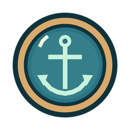
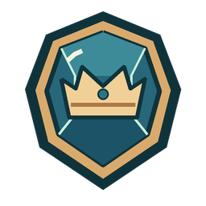

# Tideglass

A short collection puzzle for the [Azulon Unity Technical Challenge](https://azulon-studios.notion.site/Azulon-Unity-Technical-Challenge-318a171fde23808c91fec583552481ab). A storm has darkened three lights along the coast. As their keeper, salvage optical lenses, fit two into the lamp and match the signal each beacon needs.

        

## Run

1. Clone this repository or extract its source archive. In Unity Hub, choose **Add project from disk** and select the folder containing `Assets`, `Packages` and `ProjectSettings`.
2. Open it with **Unity 6000.3.21f1**. Allow the first package resolution and asset import to finish.
3. Open `Assets/Tideglass/Scenes/Station.unity` and press **Play**. Start with a 1280 × 720 Game view. The same scene is enabled for standalone builds.
4. Collect lenses into the three-slot bag. Mount up to two of your lenses in the lamp to change its beam. Unmount a lens to try a different pair. Match the target and light the beacon to unlock the next stretch of coast.

Each lens has one charge. Lighting a beacon spends the two mounted lenses. A third, unmounted lens stays in your bag for the next beacon. Unmounting preserves the lens and its charge. The catalogue names the beacon that unlocks each locked lens and keeps collected and spent lenses visible. A resonance bonus reads the partner's **printed base power**. Both bonuses are evaluated independently.

## Work in Rider

In Unity, choose **Edit → Preferences → External Tools → External Script Editor → JetBrains Rider**. Then choose **Assets → Open C# Project**. The JetBrains Rider Editor package generates a solution with the runtime and test assemblies. You can also open the generated `.sln` directly in Rider and use **Navigate → Go to Declaration or Usages**.

## Where to look

| Path under `Assets/Tideglass` | Responsibility |
| --- | --- |
| `Runtime/Domain/` | A plain C# session owns inventory, sockets, calibration and route progression. The assembly has no engine references. |
| `Runtime/Content/` and `Data/` | ScriptableObjects define the coast, lenses, icon references and reusable effects. The coast turns authoring data into a fresh session. |
| `Runtime/Station.cs` | The scene entry point connects the catalogue, session and UI document. |
| `Runtime/Presentation/` | The UI Toolkit view binds the authored layout to the session and sends player actions back to it. |
| `Art/Lenses/` | Eight original transparent lens icons. |
| `Tests/` | Coverage of gameplay rules, imported assets, route solvability and the running scene. |

## Edit the UI

Stop Play Mode and open the UXML asset in UI Builder. Double-click it in the Project window, or open **Window → UI Toolkit → UI Builder** and choose **File → Open** in the viewport. Save edits with **File → Save** in UI Builder. [Unity UI Builder guide](https://docs.unity3d.com/6000.3/Documentation/Manual/UIB-interface-overview.html)

For a full station preview, select `Station.uxml` at the top of the Hierarchy, set **Canvas Size** to 1280 × 720 in the Inspector, and choose **Fit viewport**.

| Edit | File |
| --- | --- |
| Station layout and fixed captions | [`Station.uxml`](Assets/Tideglass/Resources/Interface/Station.uxml), assigned to **Tideglass Station → UI Document → Source Asset** in `Station.unity` |
| Catalogue card layout | [`LensCard.uxml`](Assets/Tideglass/Resources/Interface/LensCard.uxml) |
| Bag slot layout | [`BagSlot.uxml`](Assets/Tideglass/Resources/Interface/BagSlot.uxml) |
| Colours, spacing and shared styles | [`Tideglass.uss`](Assets/Tideglass/Resources/Interface/Tideglass.uss) for the station, [`LensCard.uss`](Assets/Tideglass/Resources/Interface/LensCard.uss) for catalogue cards |
| Beacon illustration and beam | Edit `BeaconUnlit.svg` and `BeaconLit.svg` in [`ArtSource/Beacon`](ArtSource/Beacon), then replace their matching transparent 740 × 400 PNGs in [`Assets/Tideglass/Art/Beacon`](Assets/Tideglass/Art/Beacon). Keep the filenames and matching framing. |

To move **Light beacon**, open `Station.uxml` and drag `ignite` above `beam-indicator` in the **Hierarchy**. Keep them at the same nesting level. To change a fixed caption, select its Label and edit **Text** in the Inspector. Save, return to `Station.unity` and press Play.

Open `LensCard.uxml` to rearrange the title, icon or action for every card. The example text is for preview. For a particular lens's title, description or icon, edit its `LensDefinition` in `Data/Lenses`. Keep element names when moving controls. The view uses them to bind button actions and update values such as beam power, bag contents and lens availability.

## Add a lens or a behavior

1. In the Project window, select **Create → Tideglass → Lens**. Give it a unique ID, display name, description, Texture2D icon and base power. Set **Unlock After** to the number of lit beacons needed. Zero makes it available immediately.
2. For a resonance effect, choose **Create → Tideglass → Effects → Even partner bonus**, set **Bonus**, and drag the asset into the lens's **Effect** field. The hint displays the configured amount automatically.
3. Append the lens to **Lenses** in `Data/Coast.asset`. Start a fresh session to see it in the catalogue. If an entry is missing or uses an existing ID, the Console identifies its slot in the coast asset.
4. To introduce a different rule, derive a ScriptableObject from `LensEffect`, implement `BonusFor(int partnerBasePower)` and `Hint`, and give it a `CreateAssetMenu`. Assign its asset to any lens. The inventory and UI consume the same interface.
5. To add another stop, append a beacon to **Beacons** in the coast asset. Set its location, title and target, then configure newly reachable salvage for that stage. Run the content tests to check that every reachable bag can still finish the route.

## Verify and record

Open **Window → General → Test Runner**. Run **EditMode** and **PlayMode** separately. For a desktop build, open **File → Build Profiles**, select a desktop platform with build support installed, confirm **Station** is enabled in the scene list, and choose **Build and Run**.

[Local review checklist](Docs/REVIEW.md) · [English walkthrough and demo route](Docs/WALKTHROUGH.md)
